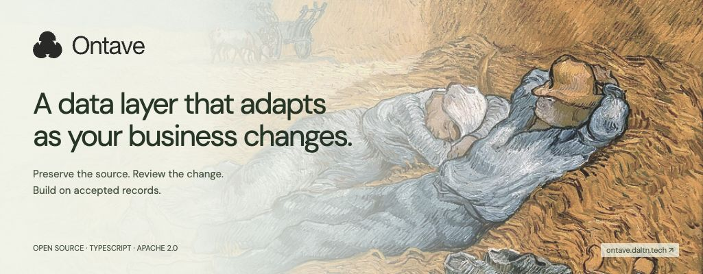

<p align="center">
  <a href="https://ontave.daltn.tech/"></a>
</p>

<p align="center">
  <a href="https://www.npmjs.com/package/ontave"></a>
  <a href="LICENSE"></a>
  <a href="https://nodejs.org/en/download"></a>
</p>

<p align="center">
  <a href="https://ontave.daltn.tech/">Website</a> ·
  <a href="https://ontave.daltn.tech/docs/">Documentation</a> ·
  <a href="https://ontave.daltn.tech/playground/">Playground</a> ·
  <a href="https://ontave.daltn.tech/index/">The Ontave index</a>
</p>

# Ontave

A data layer that adapts as your business changes.

Ontave is an Apache 2.0 TypeScript framework for applications that need to adopt unfamiliar information while preserving evidence and existing query contracts. Strict review is the default; alpha.5 adds bounded automatic adoption selected by the host application.

**Developer preview `0.1.0-alpha.6`.** This alpha is intended for developer evaluation. Full MVP qualification remains open, including independent label review, live identity/discovery/publication checks and experimental-provider resource profiling. See the [packaged release status](https://github.com/smileplis/ontave/blob/v0.1.0-alpha.6/docs/RELEASE_STATUS.json) and [implementation status](https://github.com/smileplis/ontave/blob/v0.1.0-alpha.6/docs/IMPLEMENTATION_STATUS.md).

## Try Ontave

[Browser sandbox](https://ontave.daltn.tech/playground/) · [Quickstart](https://ontave.daltn.tech/docs/quickstart/) · [API reference](https://github.com/smileplis/ontave/blob/v0.1.0-alpha.6/docs/API_REFERENCE.md)

With **Node.js 24** on macOS or Linux:

```sh
npx --yes ontave@0.1.0-alpha.6 playground --install
```

Open the localhost URL printed in the terminal. The explicit command prepares a temporary PostgreSQL database and restricted role. `--install` downloads optional platform tooling into a temporary directory if needed. No Docker or model key is required. Ctrl+C stops the playground and removes the temporary database.

The local playground uses real SDK/database operations with an explicitly fictional fixture adapter. The hosted browser sandbox replays reference runs from that same SDK harness. Neither demonstrates arbitrary-message model accuracy. Try the roof-inspection and payment-claim scenarios, inspect the source, evaluate the proposal, approve the model, confirm identity links and accept or reject the facts.

## Install in your application

```sh
npm install ontave
npx ontave help
```

The package is ESM for trusted Node.js 24 servers with a dedicated PostgreSQL 18 database. Qualification uses Node.js 24.22.0, PostgreSQL 18.4 and TypeScript 7.0.2. Browser and edge runtimes are unsupported. The default npm installation selects the current alpha preview. Core imports perform no setup or provider calls. Follow the [package quickstart](https://github.com/smileplis/ontave/blob/v0.1.0-alpha.6/docs/QUICKSTART.md) for your own data, model and authorization.

Build from source:

```sh
git clone --branch v0.1.0-alpha.6 https://github.com/smileplis/ontave.git
cd ontave
npm ci
npm run playground
```

## Policy safety fix in alpha.6

Upgrade with `npm install ontave@latest`. Automatic acceptance now treats existing records as read-only references. A changed quotation currency, supplier, price, quantity, missing field, identifier or existing relationship stays pending for explicit review. Matching references do not add assertions or increment entity revisions. Checks and writes share one transaction with revision checks and row locks; a rejected bundle commits no partial facts.

New delivery commitments can still be accepted automatically under the configured additive policy. Earlier alpha.5 decisions remain in the audit history; upgrading does not silently repair already accepted conflicts. See [policy safety and upgrade guidance](docs/POLICY_SAFETY.md).

## Added in alpha.5

Persistent local setup and a ready review Studio:

```sh
npm install ontave
npx ontave dev --install
```

Or use `openOntave` from `ontave/local` to ingest, process and open Studio in a few lines. Database provisioning, restricted roles and private local workspace identity are handled for you. [Local setup and optional hosting](docs/LOCAL_AND_HOSTED.md).

The [frozen quotation milestone](docs/ADAPTATION_MILESTONE.md) learns delivery commitments without manual adaptation review under a trusted additive policy. Its normalized development replay stored 37/39 commitments and preserved 99 old-query checks per arm. A flexible LLM + PostgreSQL baseline achieved the same quality with lower local overhead. Earlier failures are retained; independent holdouts, developer effort savings and production qualification remain open.

## What it does

- Preserves text/JSON evidence with exact source references and idempotent durable jobs.
- Stages interpretations for whole-bundle review, with scoped identity decisions.
- Keeps acceptance separate from verification and exposes value, unknown, missing and conflict field states.
- Proposes additive model changes and checks exact evaluation artifacts before activation/replay.
- Pins application contracts and generates TypeScript declarations and executable validators.
- Queries current accepted data using a bounded structured API, without an inference call.

```ts
const receipt = await ontave.ingest(context, {
  source: "messages",
  idempotencyKey: "message-014",
  payload: { kind: "text", text: "Ramesh needs to inspect the roof." },
});
```

`ontave` above is a configured server runtime. The receipt preserves evidence and a job; processing and review are separate operations. [Walk through the complete setup](https://github.com/smileplis/ontave/blob/v0.1.0-alpha.6/docs/QUICKSTART.md).

## Your infrastructure, explicit boundaries

The host resolves authenticated actor, workspace, capabilities and trusted source policy. PostgreSQL uses a separate restricted runtime role with forced row-level security. Database credentials and model keys belong on the server.

Gemini is an explicit replaceable adapter, with full-request token preflight. Experimental Mistral and OpenRouter adapters are explicit alternatives; Groq supports extraction only. Model output is validated and cannot approve changes. Accepting “I paid” as a correctly extracted claim does not independently verify payment.

Alpha.5 adds explicit bounded additive adoption and reported-fact acceptance; exceptions stay pending. Ontave does not perform destructive model changes, physical business-table migrations or automatic established-entity merging. There is no hosted database service, browser/edge SDK or React data hooks.

## Verify locally

```sh
npm test
npm run test:integration
npm run verify:package
npm run verify:node
npm run verify:next
npm run verify:domains
npm run measure:benefits
npm run measure:load
# Optional PostgreSQL operator client tools are required:
npm run verify:restore
```

Tests use fictional fixtures and disposable databases. Deterministic tests make no paid model calls. Live smoke checks do not establish the declared 95% precision / 90% recall targets; three new development trials met the aggregate field targets, while independent labels and identity/discovery qualification remain open. See the quality report for all earlier failures and the revised scoring policy.

The static documentation/marketing site lives in `website`:

```sh
npm ci --prefix website
npm run build --prefix website
npm run check --prefix website
npm run dev --prefix website
```

## Measured benefits and release qualification

**Alpha.5** adds a [runnable supplier-quotation comparison](examples/supplier-quotes/README.md) against standalone LLM + PostgreSQL. The [benchmark report](docs/SUPPLIER_QUOTATION_BENCHMARK.md) includes shared live predictions, failure history, accepted-data coverage and an exploratory timed review. It makes no framework extraction-uplift or human time-saving claim. Optional models on non-inference services and `reviews.forJob` are available in alpha.5.

The local deterministic benefit harness avoided 400 repeated extraction calls across 500 deliveries of 100 distinct inputs. Another 1,000 structured reads used no model calls. These are operation counts, not human time-saving or live accuracy claims. See [user benefits](https://github.com/smileplis/ontave/blob/v0.1.0-alpha.6/docs/USER_BENEFITS.md) and the [quality report](https://github.com/smileplis/ontave/blob/v0.1.0-alpha.6/docs/QUALITY_REPORT.md).

Alpha.6 uses a developer-preview release profile with implementation, recovery, consumer, security and exact-revision CI checks, plus a disclosure of every open quality gate. This is separate from full MVP qualification, which requires independent semantic review. See the [versioned release workflow](https://github.com/smileplis/ontave/blob/v0.1.0-alpha.6/README.md#measured-benefits-and-release-qualification) for the commands and evidence policy belonging to that release.

## Ideas to build on

- [A review boundary for agent workflows](https://ontave.daltn.tech/index/agent-workflows/)
- [Where Ontave fits alongside retrieval](https://ontave.daltn.tech/index/ontave-and-retrieval/)
- [Schema evolution and stable contracts](https://ontave.daltn.tech/index/schema-evolution/)

Follow the [RSS feed](https://ontave.daltn.tech/feed.xml), use the [JSON feed](https://ontave.daltn.tech/feed.json), or read the [plain-text context](https://ontave.daltn.tech/llms.txt).

## References

[Operator runbook](https://github.com/smileplis/ontave/blob/v0.1.0-alpha.6/docs/OPERATOR_RUNBOOK.md) · [Build report](https://github.com/smileplis/ontave/blob/v0.1.0-alpha.6/docs/BUILD_REPORT.md) · [Annotation rubric](https://github.com/smileplis/ontave/blob/v0.1.0-alpha.6/docs/ANNOTATION_RUBRIC.md) · [Architectural source reference](https://github.com/smileplis/ontave/blob/v0.1.0-alpha.6/docs/SOURCE_REFERENCE.md)

Copyright 2026 Ontave contributors. See [Apache 2.0](LICENSE) and [NOTICE](NOTICE). Cover artwork: *Noon, Rest from Work* by Vincent van Gogh. The vector wordmark and painting follow the website’s visual identity.

## Developer-preview feedback

[Report a preview issue](https://github.com/smileplis/ontave/issues/new?template=developer-preview.yml). Share setup friction, review effort and the workflow you want to support, with a fictional or redacted reproduction. The playground does not send telemetry or your messages to us.
